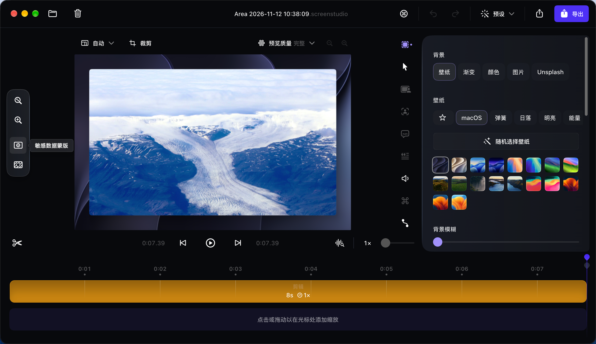
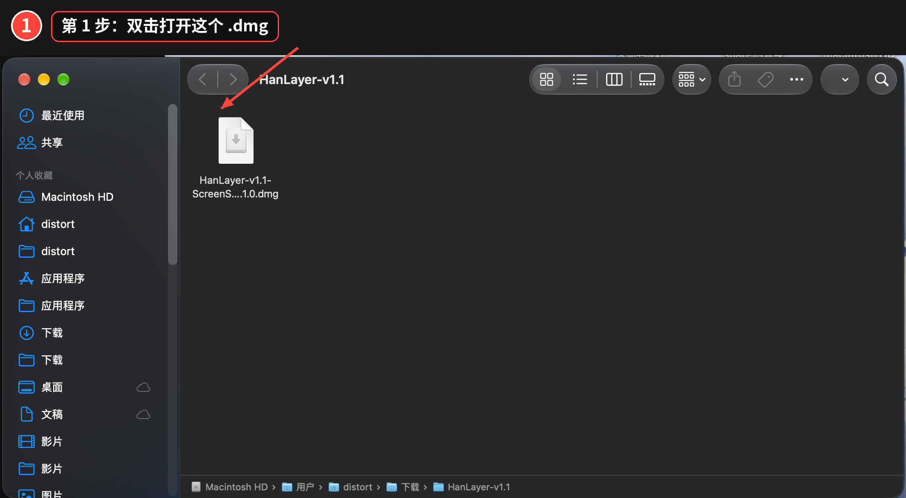
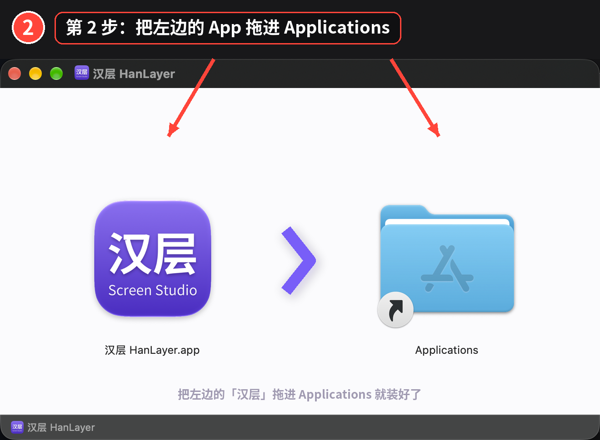
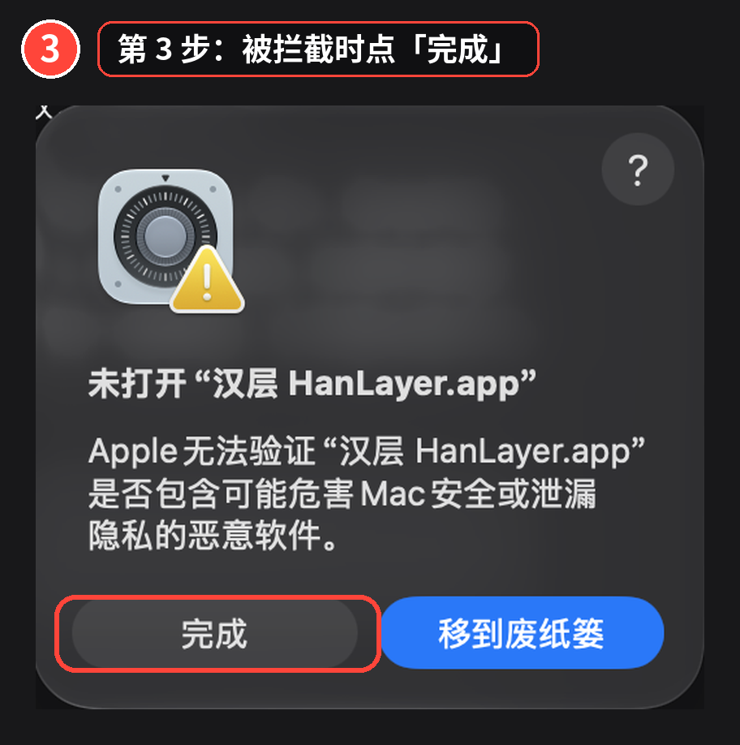
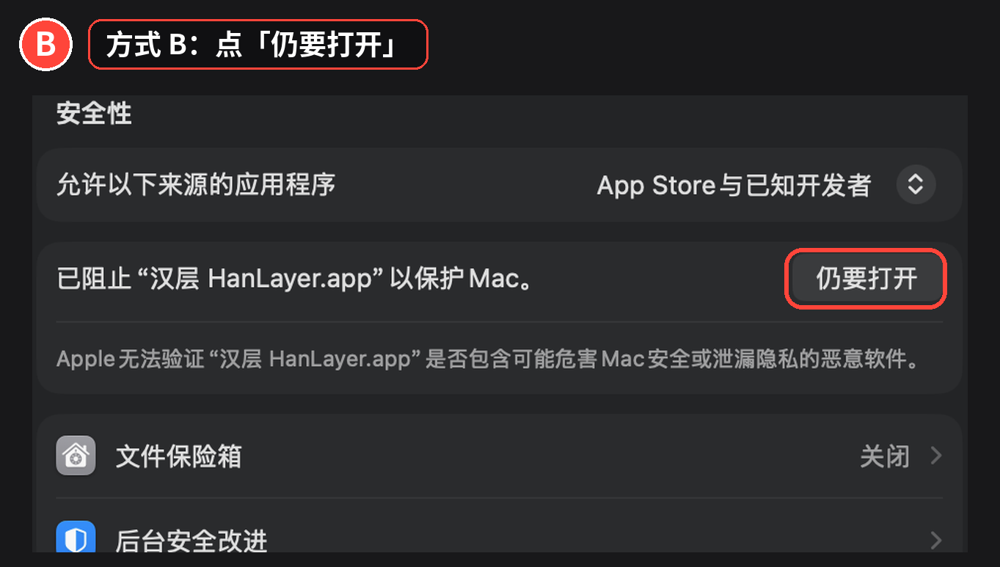
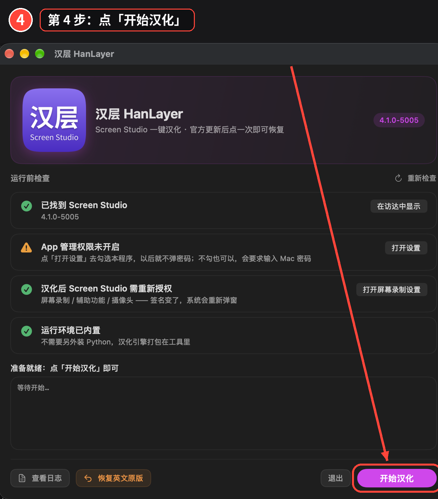

# 汉层 HanLayer · Screen Studio 简体中文汉化

给 macOS 上的 [Screen Studio](https://screen.studio)（录屏工具）换成简体中文界面的一键工具。

**不破解、不改授权、不联网、不收集任何数据。** 它只做一件事：把界面上的英文文案替换成中文。
你需要自己已经拥有正版的 Screen Studio —— 这个工具不提供、也无法绕过授权。

> ### 免责声明
>
> 本项目是非官方的第三方工具，与 Screen Studio 的开发方 **Timpler 无任何关联**，未获其授权或认可。
> 不提供、不包含、不绕过任何授权，使用前需自备正版 Screen Studio。
>
> 本工具会**修改 Screen Studio 的程序文件并重新签名**，这可能与其用户协议存在冲突，请自行判断风险。
> 因使用本工具造成的任何问题（应用损坏、权限失效、数据丢失等），由使用者自行承担。
>
> 如权利方提出异议，本项目将立即下架。



---

## 下载

到 [**Releases**](https://github.com/shizhen-ting/HanLayer-ScreenStudio/releases/latest) 页面下载 `HanLayer-v1.1-ScreenStudio-4.1.0.dmg`。

| 版本 | 对应 Screen Studio | 说明 |
| --- | --- | --- |
| v1.1 | 4.1.0（build 5005） | 当前版本，词典 2841 条 |

> 汉化原理是运行时替换界面文案，**逻辑上不绑定版本**。Screen Studio 升级后仍可直接再点一次「开始汉化」；
> 如果新版本多了新文案，那些句子会保留英文，其余照常汉化。

文件名规则：`HanLayer-<工具版本>-ScreenStudio-<词典对应的官方版本>.dmg`。
后面的官方版本代表**词典基于哪个 Screen Studio 版本整理**，不是兼容性上限——装在其他版本上同样能用，
只是新版本新增的文案会保持英文。

## 系统要求

- **Apple 芯片** Mac（M1 / M2 / M3 / M4）—— Intel 机器用不了
- macOS 12 或更高
- 已经安装并登录了正版 Screen Studio

## 兼容性

汉化靠「改 `app.asar` 后重新签名」实现，所以**受签名机制限制**，不同版本情况不同：

| Screen Studio | 情况 |
| --- | --- |
| 3.7.x | ✅ 可汉化 |
| 4.1.0-5005 | ⚠️ 开启了 hardened runtime，**用 ad-hoc 重签会被系统拒绝**，需要本机存在受信任的签名身份 |

### 如果汉化后 Screen Studio 启动即退出

系统日志里会有明确原因：

```bash
log show --last 2m --predicate 'eventMessage CONTAINS "amfid"' | tail
```

看到下面这句，就是签名身份不被信任：

```
The file is adhoc signed or signed by an unknown certificate chain
```

**工具会自动修复**：检测到证书存在但未被信任时，会用用户级信任设置把它加进去
（`security add-trusted-cert`，不需要管理员密码）。修复后签名身份即可用。

工具还会在改动任何文件**之前**检测环境，不满足就直接报错，不会把你的 App 改坏。
已经汉化坏的，用「恢复英文原版」即可还原。

### 汉化前请先确认原版能正常打开

汉化只改界面文案，**不负责让 App 能运行**。如果原版 Screen Studio 本身就打不开，
先解决这个问题再汉化，否则会误以为是汉化导致的。

判断方法很简单：装好原版后先双击打开，能正常出现在屏幕上再汉化。

如果原版打不开，先检查是不是安装状态不干净——用系统自带解压工具重新解压 zip，
把 `/Applications` 里的旧副本彻底删除后再拷入，而不是覆盖安装。

## 安装

一共四步，每一步都标了要点的位置。

### 第 1 步 · 打开 DMG

双击刚下载的 `HanLayer-v1.1-ScreenStudio-4.1.0.dmg`。



### 第 2 步 · 拖进「应用程序」

把左边的「汉层 HanLayer」拖到右边的 `Applications` 文件夹。



### 第 3 步 · 处理「无法验证开发者」

双击打开它。如果弹出「未打开 "汉层 HanLayer.app"」，**点「完成」**，然后二选一：



**方式 A（推荐，一次搞定）** 打开「终端」，粘贴执行：

```bash
xattr -dr com.apple.quarantine "/Applications/汉层 HanLayer.app"
```

然后重新打开，不再有任何提示。以后更新版本也不需要再执行。

**方式 B（纯图形界面）** 系统设置 → 隐私与安全性 → 滚到最下面「安全性」区块 → 点「仍要打开」→ 输入 Mac 密码。



> **为什么会有这一步**：工具是 ad-hoc 签名、没有 Apple 公证（个人项目，没有每年 $99 的开发者账号）。第一次打开必然被拦，这是正常现象，**不是文件损坏**。
>
> **注意**：macOS 15 起苹果已经取消了「右键 → 打开」的绕过方式，网上那些让你右键打开的老教程在新系统上无效。

### 第 4 步 · 点「开始汉化」

确认四项检查都打勾，点右下角「**开始汉化**」，进度条走完约 5～10 秒。



完成后点「打开 Screen Studio」即可。

如果弹出要密码的窗口，输入你的 **Mac 登录密码**（macOS 不允许普通 App 直接修改 `/Applications` 里的其它 App）。
想以后不再输密码：系统设置 → 隐私与安全性 → App 管理，把「汉层 HanLayer」打开。

## 汉化后第一次要重新授权（只需一次）

汉化会重新签名 App。macOS 认的是「签名身份」，签名变了，系统会把你当成一个新 App，
所以屏幕录制 / 辅助功能 / 摄像头需要重新授权**这一次**：

1. Screen Studio 弹窗请求「屏幕录制」→ 允许
2. 系统设置 → 隐私与安全性 → 屏幕录制 → 勾上 Screen Studio
3. 提示「将无法录制屏幕内容，直至退出」时，点「退出并重新打开」
4. 「辅助功能」同样做一遍

之后 Screen Studio 再更新，只要再点一次「开始汉化」，**权限不会再失效**。

## 常见问题

**提示「无法验证开发者」/「已损坏」/「未打开」？**
见上面「第 3 步」。一句话版：终端执行
```bash
xattr -dr com.apple.quarantine "/Applications/汉层 HanLayer.app"
```
再重新打开即可。**不要再按网上教程「右键 → 打开」**，macOS 15 起这个方式已失效。

**汉化后发现个别文字还是英文？**
说明用的是旧词典（工具更新过），而 App 里注入的还是上一版。
先点「恢复英文原版」，再点「开始汉化」重新注入即可——直接重复汉化不会覆盖旧词条。

如果是整句被页面拆开导致的混排（例如「我同意 服务条款 and 隐私政策」），
把截图发到 Issues，补一条词条就能修好。

**权限开关是开的，但 Screen Studio 说没权限？**
签名和系统记录对不上号，清掉旧记录再重新授权：
```bash
tccutil reset ScreenCapture com.timpler.screenstudio
tccutil reset Accessibility com.timpler.screenstudio
```
然后重新打开 Screen Studio，按提示授权，**完全退出（⌘Q）后再打开**。

**想变回英文？**
点工具里的「恢复英文原版」，它会用自动备份把 App 还原。

**⚠️ 卸载 Screen Studio 之前**
请先点「恢复英文原版」，否则重装后可能出现「权限开关是开的但录不了」。

**个别地方还是英文？**
这版 Screen Studio 有新文案，词典还没覆盖。欢迎到 [Issues](https://github.com/shizhen-ting/HanLayer-ScreenStudio/issues) 提一句，附上截图。

**想看日志？**
`~/Library/Logs/SSHanHua.log`，也可以点工具里的「查看日志」。

## 文件校验

发布包 SHA-256（v1.1）：

```
24448861836808ee3cfcb6ec893c33549b7c5ab0cb5678e9c63dc4b67eceb35e
```

核对方式：
```bash
shasum -a 256 ~/Downloads/HanLayer-v1.1-ScreenStudio-4.1.0.dmg
```

## 它是怎么工作的

Screen Studio 是 Electron 应用。汉化过程：

1. 把 `app.asar` 解包
2. 注入中文层：渲染层 DOM 文本、preload、主进程逐窗口注入、菜单栏 shim、IPC 载荷递归翻译
3. 重新打包，删除已失效的 `ElectronAsarIntegrity`，用 ad-hoc 重新签名
4. 装回 `/Applications`，重启 Screen Studio

每次运行都会自动把原始 `app.asar` 备份到 `~/Library/Application Support/Screen Studio 汉化/`（目录名固定，升级后旧备份仍可用），
所以随时可以回滚。整个流程幂等，重复运行是安全的。

**没有做的事**：不修改任何授权、订阅、许可证校验代码；不联网；不写入系统目录以外的地方；不收集数据。

## 技术文章

[**给 Electron 应用做外挂式汉化：不改原程序、随时可回滚**](docs/electron-i18n.md)

六层注入、asar 重打包、重签名与 TCC 权限的完整踩坑记录。这套方法不依赖具体应用，
可以套用到任何 Electron 程序上，不只是 Screen Studio。

## 源码与自行构建

本仓库是完整源码，不只是发布包：

| 目录 | 内容 |
| --- | --- |
| `app-src/` | 工具本体的 Swift 源码（`AppMain.swift`、`Engine.swift`）与图标源文件 |
| `engine/` | 汉化引擎 `localize.py`，以及 asar 解包 / 打包工具 |
| `app-src/Engine.swift` | 其中的 asar 读写部分已抽成独立库 [swift-asar](https://github.com/shizhen-ting/swift-asar)，可单独复用 |
| `build/` | 2841 条词典 `dict.json`、动态文案规则 `patterns.json`、渲染层注入脚本 |
| `dmg/` | 安装盘配置与背景图 |
| `apply.sh` | 官方更新后一条命令重新汉化（幂等，可重复跑） |

**一键构建**（编译 → 组装 → 签名 → 打包 DMG）：

```bash
PYTHON=/path/to/python3 ./build.sh        # 默认版本号 1.1
PYTHON=/path/to/python3 ./build.sh 1.2    # 指定版本号
```

完成时会打印 App 路径、DMG 路径和 SHA-256。

依赖：
- Xcode 命令行工具（`swiftc`、`codesign`）
- `dmgbuild`（`pip install dmgbuild`），用 `PYTHON=` 指定装它的解释器
- 汉化引擎若未预先构建，脚本会尝试用 PyInstaller 自动构建（`pip install pyinstaller`）

> 源文件叫 `AppMain.swift` 而不是 `main.swift`，因为 Swift 规定 `main.swift` 只能放顶层代码，与 `@main` 属性冲突。

**重新汉化已安装的 Screen Studio**：

```bash
./apply.sh
```

这个脚本会解包 → 注入中文层 → 重新打包 → 重签名 → 装回，并在 `~/Library/Application Support/Screen Studio 汉化/` 留下原始 `app.asar` 备份。

**重新打包 DMG**（需要 `pip install dmgbuild`）：

```bash
ditto <你编译或安装的>/汉层\ HanLayer.app /tmp/汉层\ HanLayer.app
cd dmg && dmgbuild -s settings.py "汉层 HanLayer" HanLayer.dmg
```

## 已知限制

- 仅 Apple 芯片
- 导出面板、授权相关界面在未激活状态下打不开，未逐屏验证
- 部分提示句被 React 拆成多个文本节点，这类碎片按片段单独翻译，可能读起来略生硬
- 词典基于 Screen Studio 4.1.0，官方更新后需要重跑一次

## 字体与授权

- **App 界面不分发任何字体文件**。所有文字都通过 `Font.system` 调用 macOS 自带字体（SF Pro / 苹方），
  由系统在运行时提供，不随安装包一起分发，因此不涉及字体授权
- **图标与安装盘背景**里的「汉层」二字，使用 [Noto Sans CJK SC](https://github.com/notofonts/noto-cjk)
  （SIL Open Font License 1.1），可免费商用、无需署名
- 本说明里所有步骤图的标注文字，也由思源黑体渲染；截图中的其余文字属于 macOS 系统界面本身
- 汉化层只替换文字内容，不改动任何字体或样式

## 卸载

先点界面上的「恢复英文原版」，把 Screen Studio 还原，再删除工具本体：

```bash
rm -rf "/Applications/汉层 HanLayer.app"
```

汉化过程会在下面这个目录留存原始 `app.asar` 备份，**每个版本约 250 MB**，确认不需要回滚后可以一并删掉：

```bash
rm -rf ~/Library/Application\ Support/Screen Studio\ 汉化
```

如果还想让 Screen Studio 之后完全恢复到"从没被汉化过"的状态，把系统授权记录也重置掉：

```bash
tccutil reset ScreenCapture com.timpler.screenstudio
tccutil reset Accessibility com.timpler.screenstudio
```

## 致谢与免责

- Screen Studio 版权归 [Timpler](https://screen.studio) 所有，本项目与官方**无任何关联**，也未获其授权或背书
- 本项目只分发界面文案替换工具，不分发 Screen Studio 本体，不包含任何授权凭据
- 请支持正版：<https://screen.studio>
- 使用本工具产生的任何后果由使用者自行承担

## License

[MIT](LICENSE)。适用于本仓库的全部内容：工具源码、汉化引擎、词典、文档与图片。

本仓库**不包含 Screen Studio 本体的任何代码或资源**。`build/dict.json` 是对界面文案的中文翻译映射，
属于本地化工作产物，不构成对原软件的再分发。
